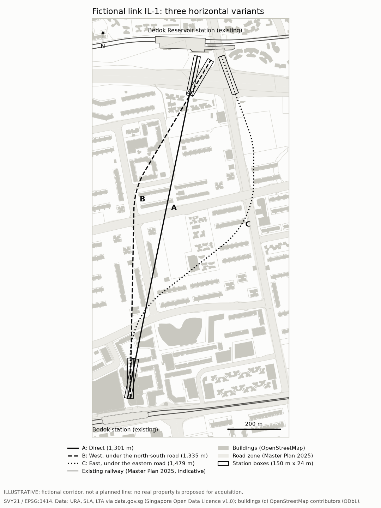
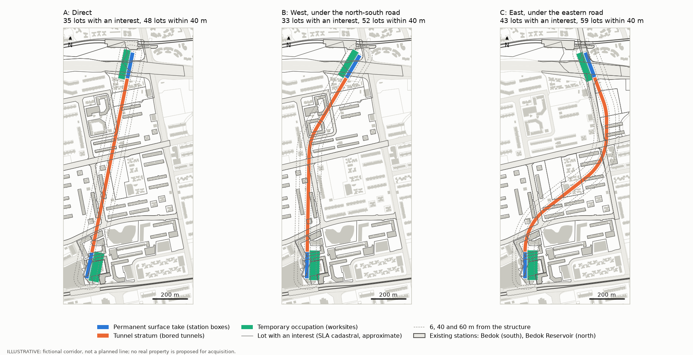
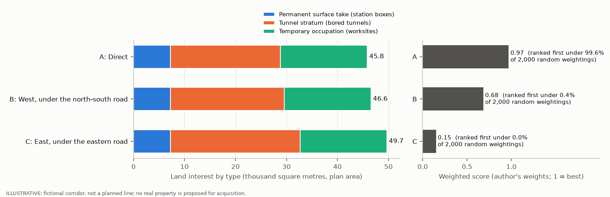

# sg-rail-corridor-land-screening

> **Read this first.** Personal portfolio project on public data, built with AI assistance. It is an
> independent desk study: not affiliated with, commissioned by or endorsed by the Land Transport Authority
> (LTA), the Singapore Land Authority (SLA) or the Urban Redevelopment Authority (URA), and it uses no
> non-public information. The rail corridor screened here is **fictional**: it is not an announced, planned
> or proposed line, and nothing here suggests that any real property would be acquired; outputs name lots by
> their key and land-use zone only. The fact sheet is a sourced summary, **not legal advice**, and nothing here
> describes how any agency handles land matters internally. Author: Wenjie Luo (GitHub LUOaini1213).

<!-- Generated by scripts/build_docs.py from results/. Edit docs/templates/README.md instead. -->

A land screening of a fictional underground link, IL-1, between two existing stations (Bedok, elevated, and
Bedok Reservoir, underground), done the way a land team might do a first pass: which surveyed lots each part
of the works would touch, how much of each lot and of what kind (permanent surface, a tunnel stratum, or
temporary occupation), what the Master Plan and SLA's open data say about each lot, which lots fall within
the railway protection distances, and which public mechanism and agency each interest points to. Three
horizontal variants are compared, the results go into a maintainable land database, and the outputs are a
land schedule, maps, a DXF and a two-page briefing note. Everything runs in Python on open data in SVY21
(EPSG:3414) with GeoPandas.



## Results at a glance

| | A: Direct | B: West, under the north-south road | C: East, under the eastern road |
|---|---|---|---|
| Route length (m) | 1,301 | 1,335 | 1,479 |
| Curves (radius 300 m) | 0 | 1 | 3 |
| Lots with a land interest | 35 | 33 | 43 |
| - of which shown as State land in SLA's open layers | 1 | 1 | 0 |
| Permanent surface take, station boxes (m2) | 7,200 | 7,200 | 7,200 |
| Tunnel stratum (m2) | 21,627 | 22,351 | 25,463 |
| - under lots not shown as State land (m2) | 20,105 | 20,402 | 25,463 |
| Temporary occupation, worksites (m2) | 17,000 | 17,000 | 17,000 |
| Buildings inside boxes or worksites (OSM) | 7 | 8 | 7 |
| Buildings above the tunnels (OSM) | 10 | 11 | 12 |
| - of which URA-listed HDB blocks | 9 | 10 | 6 |
| Lots within 40 m of the structure (any part) | 48 | 52 | 59 |
| Other lots 40 to 60 m from the structure | 22 | 30 | 29 |

- **Variant A (Direct) ranks first** under the author's weights, under equal weights,
  and under 99.6% of 2,000 random weightings; it is best or tied best on
  6 of 7 criteria. That says more about how the three variants were drawn than about any
  real alignment question.
- **The station box at the Bedok end is the main land issue in every variant**: town-centre lots zoned
  Commercial, Commercial & residential, Open space (7 to 8 lots), with 2 to 4 buildings inside the box.
- **Tenure is mostly unknown from open data.** Of the 60 lots touched by any variant, the number
  shown as State land in SLA's open layers is 1.
- **The tunnels need a stratum, not the surface,** under 18 to 26 lots per variant: the tube crown is
  assumed at -5 m SHD, above the -30 m SHD default ownership depth MinLaw described in 2015.
- **Interfaces with the existing railway**: worksites A-WS-N, B-WS-N lie within 6 m of an existing
  station outline (the first reserve), where the Code of Practice keeps site offices out.

## 1. What open data exist

Full list, licences and hashes: [docs/data_sources.md](docs/data_sources.md).

- **Cadastral lots are open.** SLA publishes every surveyed lot (key and approximate boundary) on data.gov.sg
  under the Singapore Open Data Licence; 447 lots touch the study box of 2.94 square kilometres and tile it with
  0.29 square metres uncovered. They carry no owner, tenure, title depth or encumbrance, so they
  are used as parcels but nothing is inferred about ownership.
- **State land is only partly visible**: SLA's layers of vacant State land, State land managed by its agents and
  State reserves. Most lots therefore have *unknown* tenure.
- **Zoning** comes from URA's Master Plan 2025 land-use layer as amended; **rail lines and stations** from the
  Master Plan rail layers (indicative). No open layer of railway protection lines or road reserve lines was found.
- **Buildings**: URA's Master Plan building layer holds only HDB blocks and a few building types
  (255 footprints in the box), so OpenStreetMap footprints (480 in the box, ODbL) are used for building
  counts; 237 of the 255 URA footprints are matched by an OSM footprint.
- **OneMap** was not used: its terms license use of SLA's data but, beyond that licence, bar storing, distributing
  or publicly displaying it, and applications built on its API need developer registration. No OneMap data, tiles
  or API keys are in this repository.

## 2. The rules used, sourced

[docs/fact_sheet.md](docs/fact_sheet.md) has 36 rows (33 VERIFIED, 3 UNVERIFIED), each with source, location and a short
quote. Singapore Statutes Online refused automated access, so no further request was sent to it and no bot
challenge was attempted; statutes were read from SSO-generated consolidations held by FAOLEX, with their
in-force dates. The screening uses only VERIFIED rows, and the code refuses an UNVERIFIED one:

| Used for | Value | Fact |
|---|---|---|
| First reserve | 6 m from the outer edge of the railway | F15 |
| Railway protection zone; railway corridor (from a railway area) | 40 m | F13, F12 |
| Railway safety zone | 60 m | F14 |
| Default depth of subterranean ownership, as MinLaw described the 2015 amendment | -30 m SHD (the current Act's text was not read: F22) | F21 |
| Limit checked on temporary occupation under s.42 | 3 continuous years | F10 |

Each interest is routed to the mechanism the sources describe: acquisition by s.5 declaration (surface) or of a
subterranean stratum only (s.5(1A)) if the land is not State land, a Temporary Occupation Licence on State land,
temporary occupation under s.42 on other land, and the railway corridor and protection-zone controls of LTA. As
tenure is mostly unknown, every route says what must be confirmed first. Codes are explained in
[docs/schema.md](docs/schema.md).

## 3. The fictional corridor

- **End stations.** Pairs of operating stations 1,400 to 3,600 m apart were kept when the middle of the
  straight line between them stays at least 250 m from every line on URA's Master Plan 2025 rail layer,
  which also shows lines not yet built (66 pairs passed; `scripts/survey_raw.py`). The pair chosen ranks
  8 by clearance and lies away from the areas LTA has named for its rail feasibility studies (read in LTA's
  2025 and 2026 news releases). In the drawn variants the middle part stays 331 to
  345 m from every Master Plan rail line.
- **Geometry (ASSUMPTION / ILLUSTRATIVE, `inputs/corridor.yaml`).** Tangents joined by circular arcs of
  300 m radius; cut-and-cover station boxes of 150 m by 24 m on the end straights; twin bored
  tunnels 21.6 m wide overall with the crown at -5 m SHD; worksites 40 m wide beside each box
  (wider at the launch end). Nothing was checked against design criteria; the curves only make it look like a
  railway.

## 4. Screening results

Every part of the works was overlaid on the lots in SVY21; pieces under 1 square metre are treated as
slivers of approximate lot lines and kept out of the take but inside the area accounting (each component's
area = counted pieces + slivers + area outside any lot, with a largest residual below 1e-06 square metres).



**Area by Master Plan zone (square metres; surface = station boxes, stratum = tunnels, temporary = worksites):**

| Master Plan zone | A surface | A stratum | A temporary | B surface | B stratum | B temporary | C surface | C stratum | C temporary |
|---|---|---|---|---|---|---|---|---|---|
| Commercial | 805 | - | 7,048 | 872 | - | 6,048 | 827 | - | 5,959 |
| Commercial & residential | 924 | 1,843 | 3,084 | 1,026 | 6,262 | 3,856 | 1,037 | 2,129 | 3,877 |
| Educational institution | - | 2,746 | - | - | 1,633 | - | - | 5,057 | - |
| Open space | 1,872 | - | 68 | 1,701 | - | 296 | 1,737 | - | 364 |
| Park | 1,156 | - | 2,643 | 869 | - | 2,650 | - | - | 847 |
| Place of worship | - | - | - | - | - | - | - | 144 | - |
| Reserve site | - | 806 | - | - | 16 | - | - | 138 | - |
| Residential | 397 | 11,295 | 959 | 343 | 10,151 | 410 | - | 13,824 | - |
| Residential with commercial at 1st storey | - | 1,091 | - | - | 93 | - | - | 19 | - |
| Road | 2,047 | 3,845 | 3,198 | 2,388 | 4,197 | 3,740 | 3,600 | 4,151 | 5,953 |

**What the open data say about tenure, and the mechanisms each variant points to (lots):**

| Tenure evidence (lots with an interest) | A | B | C |
|---|---|---|---|
| State land (SLA open layer) | 1 | 1 | 0 |
| Unknown | 22 | 21 | 25 |
| Unknown: Master Plan park or open space | 5 | 4 | 4 |
| Unknown: Master Plan road zone | 7 | 7 | 14 |

| Mechanism code | A | B | C |
|---|---|---|---|
| `ACQ-STRATUM` | 18 | 17 | 26 |
| `ACQ-SURFACE` | 13 | 12 | 13 |
| `RAIL-ZONE` | 57 | 65 | 76 |
| `STATE-STRATUM` | 1 | 1 | 0 |
| `STATE-SURFACE` | 1 | 1 | 0 |
| `TEMP-OCC` | 14 | 14 | 16 |
| `TOL` | 1 | 1 | 0 |

**Distances to the existing railway** (measured to the indicative Master Plan line and to the station outline;
the structure edge is nearer than the line, so a band here is a lower bound on proximity):

| Component | Distance to the indicative line (m) | Distance to the station outline (m) | Band |
|---|---|---|---|
| A-BOX-S | 80.9 | 51.3 | 40 to 60 m |
| A-BOX-N | 52.2 | 14.2 | 6 to 40 m |
| A-TUN | 200.5 | 163.2 | beyond 60 m |
| A-WS-S | 29.2 | 24.7 | 6 to 40 m |
| A-WS-N | 52.0 | 2.9 | within 6 m |
| B-BOX-S | 74.6 | 52.3 | 40 to 60 m |
| B-BOX-N | 55.3 | 27.8 | 6 to 40 m |
| B-TUN | 196.3 | 156.3 | beyond 60 m |
| B-WS-S | 40.0 | 37.7 | 6 to 40 m |
| B-WS-N | 32.4 | 0.0 | within 6 m |
| C-BOX-S | 74.8 | 52.5 | 40 to 60 m |
| C-BOX-N | 42.1 | 18.0 | 6 to 40 m |
| C-TUN | 186.2 | 161.9 | beyond 60 m |
| C-WS-S | 41.3 | 38.8 | 6 to 40 m |
| C-WS-N | 40.6 | 20.7 | 6 to 40 m |

## 5. Comparing the variants

All criteria are lower-is-better; scores are min-max across the three variants (1 = best). Weights are the
author's ASSUMPTION ([inputs/scoring.yaml](inputs/scoring.yaml)).

| Criterion (lower is better) | Weight | A | B | C |
|---|---|---|---|---|
| Permanent surface take on lots not shown as State land (m2) | 0.20 | 6,803 (1.00) | 6,857 (0.87) | 7,200 (0.00) |
| Tunnel stratum under lots not shown as State land (m2) | 0.15 | 20,105 (1.00) | 20,402 (0.94) | 25,463 (0.00) |
| Lots with any land interest (count) | 0.15 | 35 (0.80) | 33 (1.00) | 43 (0.00) |
| Buildings inside boxes or worksites (count) | 0.15 | 7 (1.00) | 8 (0.00) | 7 (1.00) |
| Buildings above the tunnels (count) | 0.15 | 10 (1.00) | 11 (0.50) | 12 (0.00) |
| Lots within the 40 m protection distance of the structure (count) | 0.10 | 48 (1.00) | 52 (0.64) | 59 (0.00) |
| Route length (m) | 0.10 | 1,301 (1.00) | 1,335 (0.81) | 1,479 (0.00) |
| **Weighted score** | 1.00 | **0.97** | **0.68** | **0.15** |

| Weighting | Ranking |
|---|---|
| Author's weights | A > B > C |
| Equal weights | A > B > C |
| Values within 5% of the best treated as ties | A > B > C |
| Each weight x0.5 or x1.5 in turn (14 runs) | same winner in 14 of 14 |
| Each criterion left out in turn (7 runs) | same winner in 7 of 7 |
| 2,000 random weightings: share ranked first | A 99.6%, B 0.4%, C 0.0% |



**Why no costs.** Compensation under the Land Acquisition Act is the market value of each acquired lot or
stratum as at the notification or declaration date, plus listed heads (F04, F24), assessed case by case. No
public schedule of unit rates for that exists in the sources used, and land-sale or licence rates are prices for
other transactions, so a money figure would be invented. Areas, lot counts and buildings are reported instead.

## 6. Land database

[outputs/land_db.gpkg](outputs/land_db.gpkg) (GeoPackage) holds parcels, alignment versions, affected areas,
interests, the status of each acquisition or occupation step, documents, a change log and the validation rules;
schema and rules in [docs/schema.md](docs/schema.md). It holds 4 alignment versions, 452 interests and
1,665 steps; all 12 validation rules pass (0 failures), and a test plants an error for each rule.
Statuses, dates and documents are SYNTHETIC.

**Updating when the alignment changes.** The demo revises version A-v1 to A-v2
(A rev 1: north end moved 40 m east): 11 interests left scope (withdrawn; 1 step already completed is flagged for
review), 11 came into scope, and 89 continuing interests changed area; 123 changes are logged.

## 7. Outputs

| File | What it is |
|---|---|
| [outputs/briefing_note.pdf](outputs/briefing_note.pdf) ([Markdown](docs/briefing_note.md)) | Two-page briefing note: what is affected, land issues and the agency for each (per public sources), risks, next steps |
| [outputs/land_schedule.xlsx](outputs/land_schedule.xlsx) | Land schedule: one sheet per variant (58, 66 and 77 lots: those with an interest or within 60 m of the structure) with totals as SUM formulas, a summary, read-me and sources; a test checks the totals against Python |
| [outputs/webmap.html](outputs/webmap.html) | Interactive map (Leaflet via folium): variants, take by type, lots with pop-ups, protection distances; open in a browser (needs the internet for the base map) |
| [outputs/corridor_variants.dxf](outputs/corridor_variants.dxf) | DXF R2013 in SVY21 metres: alignments, boxes, tunnels, worksites, protection-distance lines, lots with an interest and their keys. Written and read back with ezdxf (0 audit errors); **not opened in AutoCAD, MicroStation or any other CAD package** |
| [outputs/land_db.gpkg](outputs/land_db.gpkg) | The land database (GeoPackage); written and read with GDAL and SQLite only, **not opened in QGIS or ArcGIS** |
| `figures/` | The three figures above |

No QGIS project file is included: none could be validated without QGIS, which was not used.

## 8. How it was checked

- **97 offline tests** (network blocked) on hand-computed shapes and the committed extract: circular-arc
  fillets against hand values, band area equals width times centre-line length, ring areas of the protection
  distances, area conservation per component, the SVY21 round trip (error below 1e-06 m), instrument routing,
  each database rule against a planted error, the workbook totals, DXF read-back, the briefing page count, and
  this README and the other generated documents against a fresh rendering.
- **Mutation testing** (`scripts/mutate.py`): hand-written bugs planted one at a time in geometry, zone distances,
  area accounting, scoring, the database update and the outputs, with the golden comparisons left out so that a
  kill must come from a behavioural test. First run: 48 of 55 caught. Each survivor
  (C03, S06, S07, S08, D04, D10, R02) got a test in `tests/test_round2.py`; the final run, which also includes mutants
  written for code added after the first run, caught 57 of 57 (`results/mutation.json`).
- **Quotes**: `scripts/check_quotes.py` downloads each source again and finds all 33 of
  33 VERIFIED quotes in it (`results/quote_check.json`; needs the network, so not in CI).
- **CI** (`.github/workflows/ci.yml`) runs the tests, rebuilds results, outputs and documents offline from the
  committed extract and fails if any result (compared with a small tolerance) or generated document changes; a
  second job reruns the mutation test and fails unless every planted bug is caught.
- **Adversarial self-review**: what was challenged, what changed and what is still open is in
  [docs/self_review.md](docs/self_review.md).

## Provenance

| Input | Label | Source or basis |
|---|---|---|
| Cadastral lots, airspace lots, State-land layers | **REAL** | SLA, data.gov.sg (SODL v1.0) |
| Master Plan 2025 land use, buildings, rail lines and stations | **REAL** | URA, data.gov.sg (SODL v1.0) |
| Station exits (stations in operation) | **REAL** | LTA, data.gov.sg (SODL v1.0) |
| Building footprints | **REAL** | OpenStreetMap contributors (ODbL 1.0) |
| Legal and regulatory facts | **REAL** | Fact sheet; VERIFIED rows only feed calculations |
| Areas, lot schedules, distances, tenure evidence, mechanism codes | **DERIVED** | Overlay in SVY21 |
| Scores and rankings | **DERIVED** | `inputs/scoring.yaml` applied to derived criteria |
| Box, tunnel and worksite sizes, tunnel level, curve radius, sliver and building thresholds | **ASSUMPTION** | `inputs/corridor.yaml`, `corridor/screening.py` |
| Criteria weights, tie tolerance | **ASSUMPTION** | `inputs/scoring.yaml` |
| The corridor, its variants and the revision | **ILLUSTRATIVE** | Drawn by the author; fictional |
| Step lists marked ILLUSTRATIVE in the database | **ILLUSTRATIVE** | Author's checklist |
| Step statuses, dates, document placeholders | **SYNTHETIC** | Demo only |
| Test fixtures | **SYNTHETIC** | Hand-made shapes in `tests/` |

## Limitations

- Lot lines are approximate and tenure is unknown for most lots; nothing here is a title search.
- The Master Plan layers are indicative and its rail notations diagrammatic; distances to the existing railway
  are measured to indicative lines, not to structure edges.
- OpenStreetMap buildings are volunteer-mapped; building counts depend on a 1 square metre threshold.
- Sizes, positions and levels of the works are assumptions; no design criteria were checked and no ground
  levels were used. The comparison reflects the author's variants and weights.
- Statutes were read from third-party copies of official consolidations; their in-force dates are in the fact sheet.
- Areas are plan areas; strata are described by assumed levels only.

## Reproduce

```
python -m venv .venv && .venv/Scripts/pip install -r requirements.txt   # Python 3.11 (Linux/macOS: .venv/bin/pip)
python -m pytest -q                       # offline, on the committed extract
python -m corridor.pipeline               # results/, outputs/, figures/ from the committed extract
python scripts/count_tests.py             # the test count quoted here
python scripts/build_docs.py              # README.md and docs/ from results/
python scripts/check_results.py           # what CI runs: rebuild and compare with the committed files
python scripts/mutate.py --record final   # mutation test of the test suite
python scripts/fetch_data.py && python scripts/fetch_osm.py && python scripts/build_study_area.py   # needs network; newer data give different numbers
python scripts/survey_raw.py              # island-wide checks behind the choice of end stations (needs the downloads)
python scripts/check_quotes.py            # finds every VERIFIED quote in its source again (needs network)
```

## Licence and attribution

Code and the author's text: MIT ([LICENSE](LICENSE)). Contains information from URA, SLA and LTA datasets
accessed on 2026-11-24 from data.gov.sg, which is made available under the terms of the Singapore Open Data
Licence version 1.0; use of the datasets does not imply endorsement. Building footprints (c) OpenStreetMap
contributors, ODbL 1.0; the `osm_buildings` layer and counts derived from it stay under the ODbL. Documents in
the fact sheet are cited, not reproduced; web addresses are given as plain text because several publishers'
terms ask for permission before linking.
